# GE-EHR — everything the application does, in diagrams

Reclassification-aware genomic decision support for monogenic diabetes. This page maps the
whole system: who can log in and what each role sees, every page and command, how a gene
test becomes advice or a risk level, how ClinVar changes are followed, the data model, the
data pipeline, Docker and the evaluation. Diagrams are Mermaid (GitHub, VS Code and most
Markdown viewers render them).

> Research prototype, synthetic data only. Recommendations and risk levels are advisory;
> GE-EHR never changes therapy by itself. Passwords are never written in this document.

**Contents**
1. [The big picture](#1-the-big-picture)
2. [Accounts, credentials and roles](#2-accounts-credentials-and-roles)
3. [Logging in](#3-logging-in)
4. [Pages and what each role can open](#4-pages-and-what-each-role-can-open)
5. [From gene test to advice](#5-from-gene-test-to-advice)
6. [Classification](#6-classification)
7. [Treatment rules D1–D6 (patients with diabetes)](#7-treatment-rules-d1d6-patients-with-diabetes)
8. [Genetic risk (people without diabetes)](#8-genetic-risk-people-without-diabetes)
9. [Re-evaluation when knowledge changes](#9-re-evaluation-when-knowledge-changes)
10. [Life of an alert](#10-life-of-an-alert)
11. [Family tree](#11-family-tree)
12. [Data model](#12-data-model)
13. [Data pipeline and datasets](#13-data-pipeline-and-datasets)
14. [Commands](#14-commands)
15. [Docker start-up](#15-docker-start-up)
16. [Evaluation](#16-evaluation)
17. [Security](#17-security)
18. [How it was built](#18-how-it-was-built)

---

## 1. The big picture

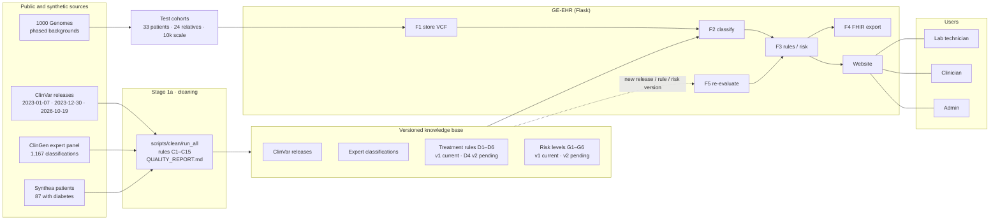

## 2. Accounts, credentials and roles

Three demo accounts are created automatically. Their **password is generated** and only
stored in a file the operator can read; it is never shown on a page, in logs or here.

| Where | Accounts | Where to read the password |
|---|---|---|
| Local development | `demo_clinician`, `demo_lab_tech`, `demo_admin` | `cat instance/dev_accounts.txt` |
| Docker | the same three | `docker compose exec web cat /app/instance/demo_accounts.txt` |
| Your own users | any name | `flask create-user NAME --role clinician` (asks for a password) |

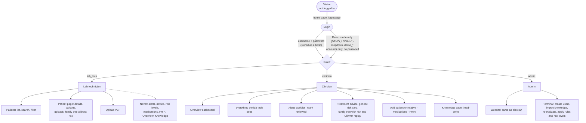

| Action | Visitor | Lab tech | Clinician | Admin |
|---|:-:|:-:|:-:|:-:|
| Home and login pages | ✅ | – | – | – |
| Overview dashboard | ❌ | ❌ | ✅ | ✅ |
| Patients list, search, With / Without diabetes filter | ❌ | ✅ | ✅ | ✅ |
| Patient page: details, variants, uploads, family tree | ❌ | ✅ | ✅ | ✅ |
| Upload a VCF | ❌ | ✅ | ✅ | ✅ |
| Alerts, review notices, info notes, history | ❌ | ❌ | ✅ | ✅ |
| Genetic risk card, risk column, family-tree risk and replay | ❌ | ❌ | ✅ | ✅ |
| Add patient / relative, medications, FHIR export | ❌ | ❌ | ✅ | ✅ |
| Alerts worklist, Mark reviewed | ❌ | ❌ | ✅ | ✅ |
| Knowledge page | ❌ | ❌ | ✅ | ✅ |
| Users, imports, re-evaluation, rule / risk revisions | ❌ | ❌ | ❌ | terminal |

## 3. Logging in

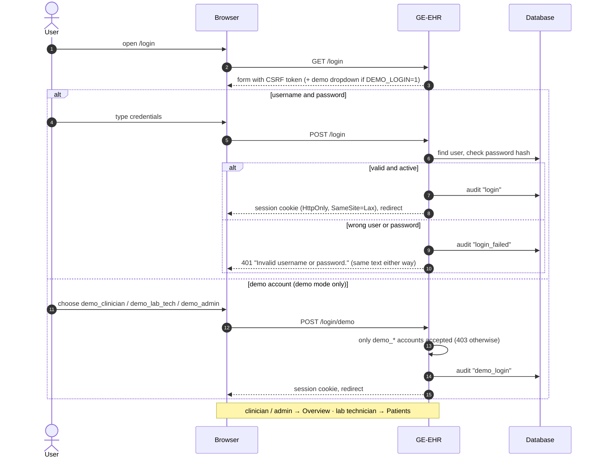

## 4. Pages and what each role can open

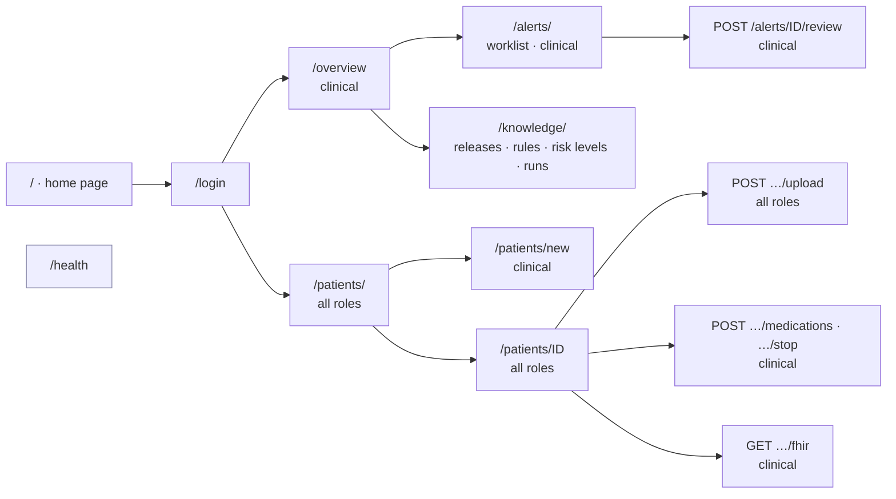

What the patient page shows:

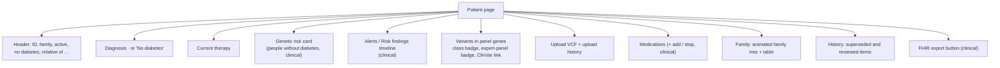

## 5. From gene test to advice

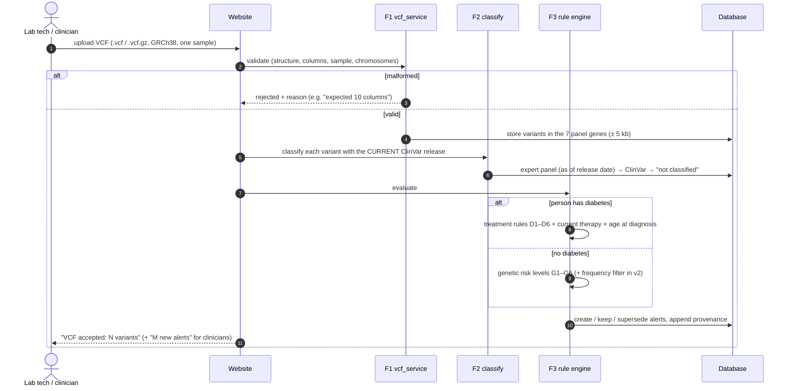

## 6. Classification

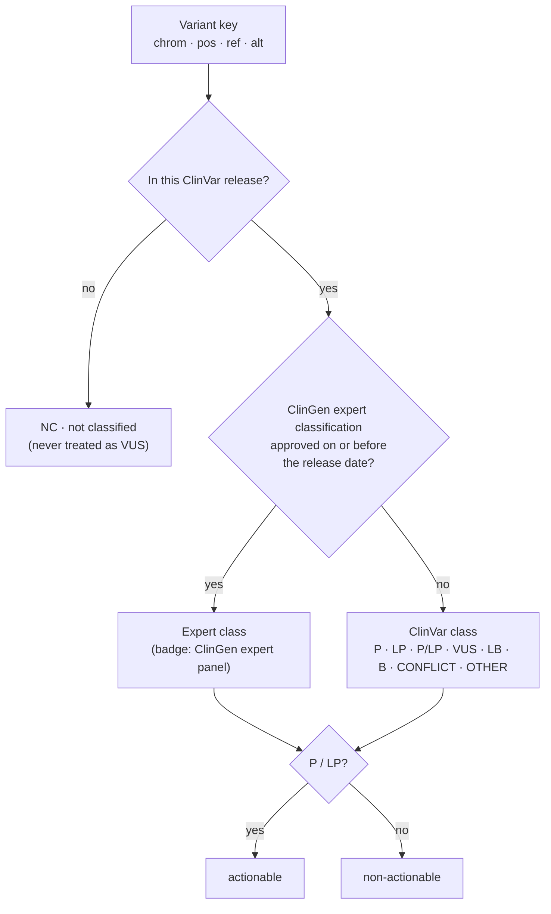

Change categories used by re-evaluation: **upgrade** (into P/LP), **downgrade** (out of
P/LP), **within actionable** (LP → P), **within non-actionable** (VUS → LB), unchanged.

## 7. Treatment rules D1–D6 (patients with diabetes)

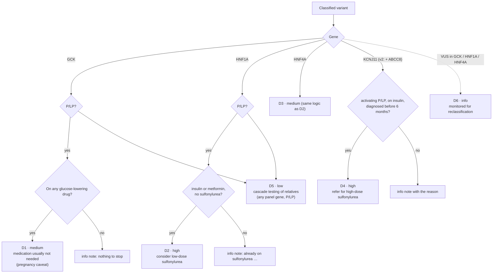

## 8. Genetic risk (people without diabetes)

Relatives offered testing (rule D5) get a risk level instead of treatment advice.

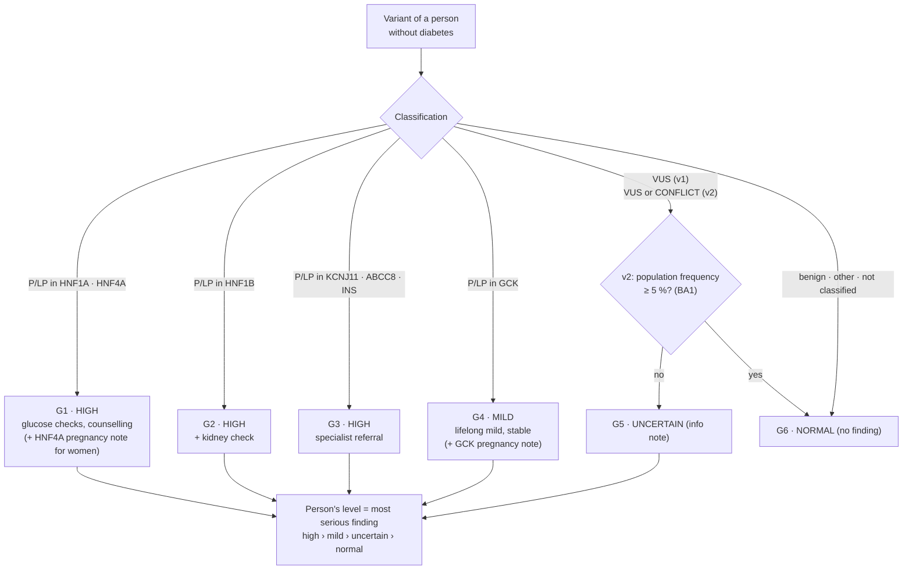

| Version | Status in the demo | What it does |
|---|---|---|
| v1 | current | CONFLICT counts as normal (healthy genomes carry 11–20 common conflicting variants) |
| v2 | pending → `flask apply-risk-levels 2` | CONFLICT counts as uncertain again, but common variants (≥ 5 %) are ignored |

## 9. Re-evaluation when knowledge changes

The paper's main contribution (F5). Only people a change can affect are re-checked.

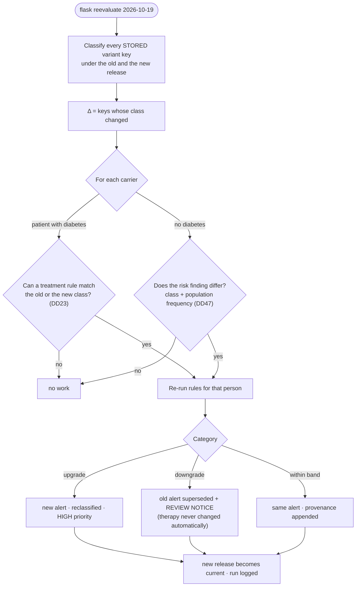

Revisions use the same idea:

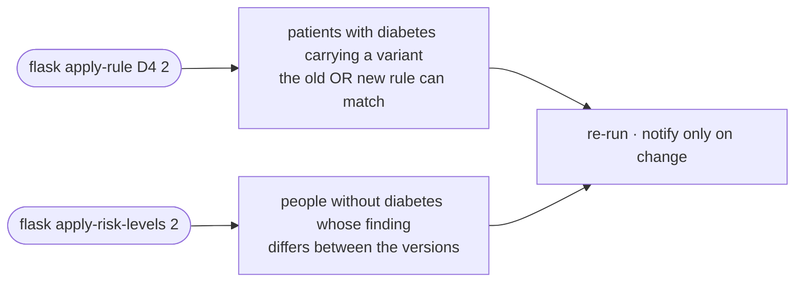

## 10. Life of an alert

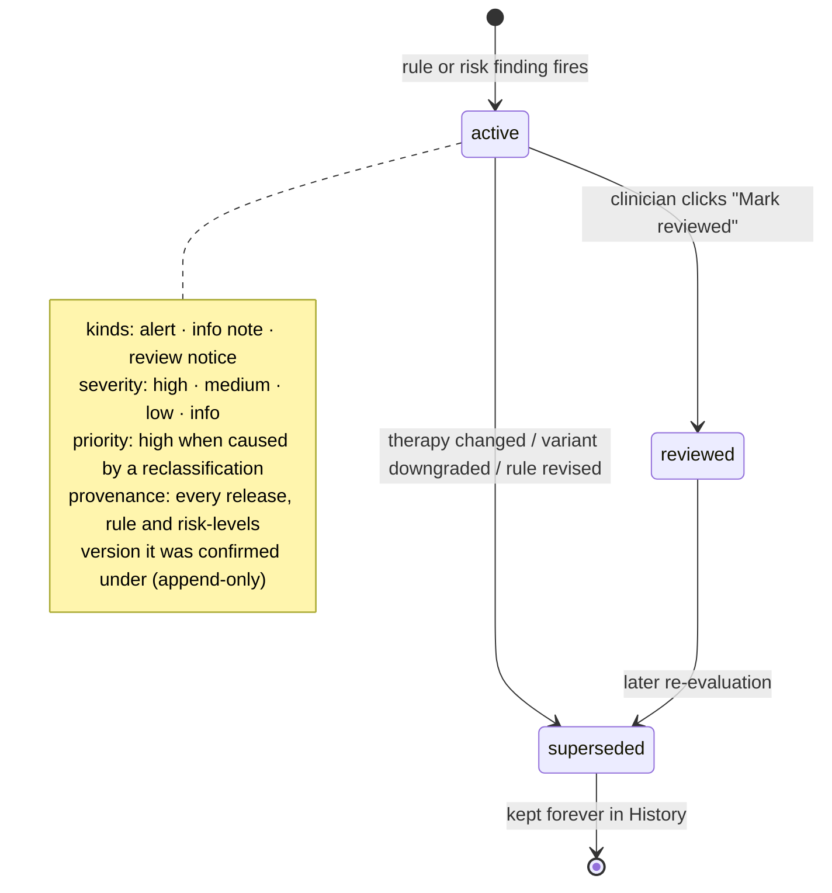

## 11. Family tree

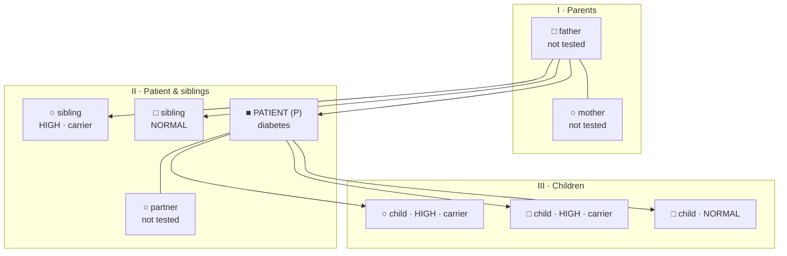

Features: pedigree symbols, age inside each symbol, risk-coloured rings and tints (clinical),
carrier badges, glowing inheritance paths to carriers, generation bands, and a **ClinVar
timeline with Replay history** that recomputes everyone's level for each release.

## 12. Data model

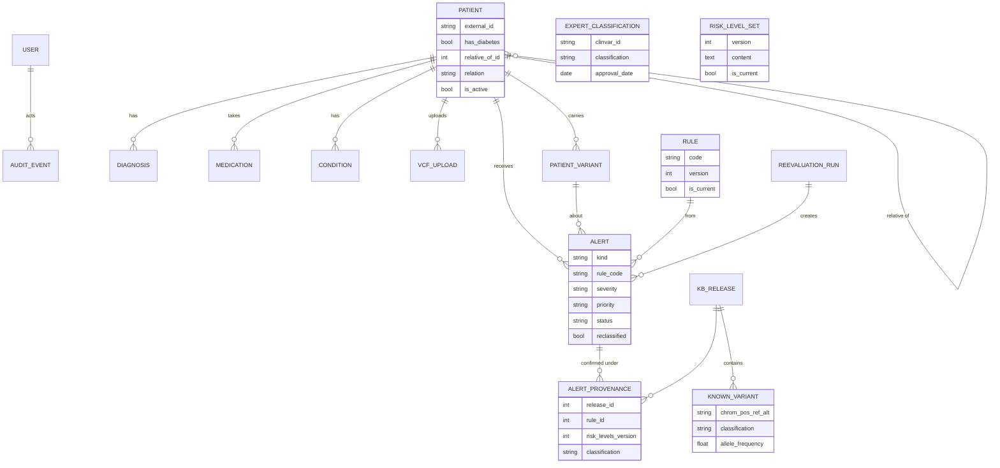

## 13. Data pipeline and datasets

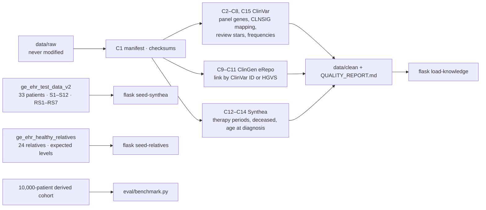

## 14. Commands

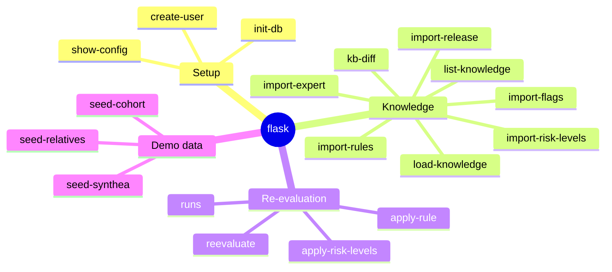

## 15. Docker start-up

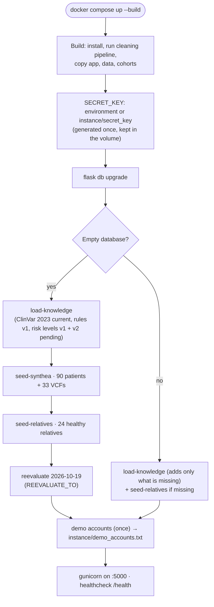

## 16. Evaluation

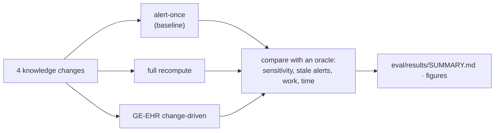

| 10,000 patients | GE-EHR | Full recompute | Missed / stale |
|---|---|---|---|
| Real ClinVar update | 1,031 patients · 29.6 s | 7,301 patients · 88.6 s | 0 / 0 |
| Rule revision D4 v2 | 20 patients · 3.8 s | 7,301 patients · 71.9 s | 0 / 0 |

## 17. Security

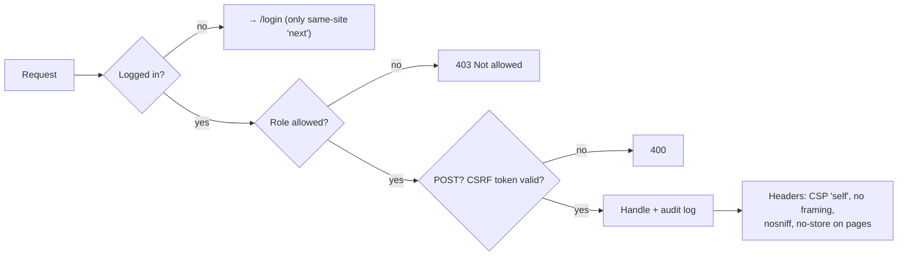

- Passwords are salted hashes; login errors never reveal whether a user exists.
- Demo login exists only with `DEMO_LOGIN=1` and only for `demo_*` accounts.
- Every login, upload, medication change, review and knowledge import is audited.
- Uploaded files are processed from a temporary file and deleted at once.

## 18. How it was built

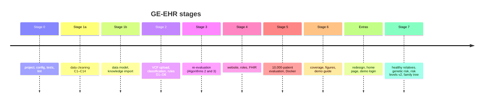

Design decisions DD1–DD48 are in `docs/DEVELOPMENT_PLAN.md`; the demo script is
`docs/DEMO.md`; the website guide is `docs/GE-EHR_Website_Guide.docx`.
